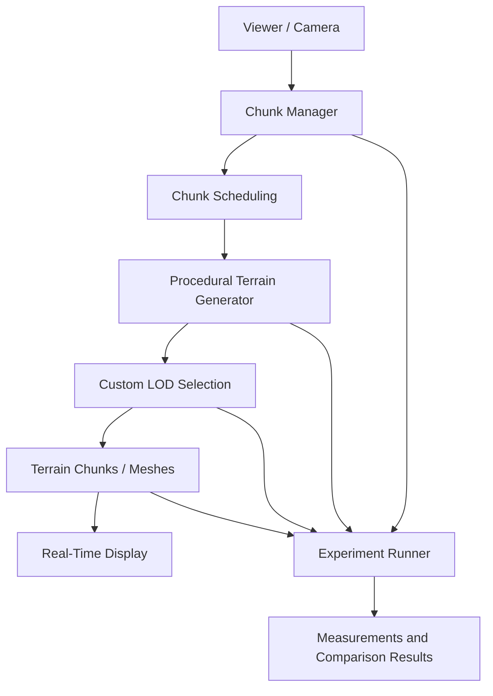

# Real-Time Procedural Terrain Generation and Level-of-Detail Management

## 1. Actors and permissions

| Role | Needs | Responsibility / access |
| --- | --- | --- |
| Viewer / experiment operator | Navigate generated terrain and observe chunk and LOD behaviour | Moves the camera/viewer and selects available test configurations |
| Student / developer | Implement and evaluate the terrain system | Designs the algorithms, runs experiments, records results, and maintains the repository |
| Project supervisor / evaluator | Assess the implementation and evidence | Reviews the technical decisions, reproducibility, and experimental findings |

## 2. Use cases / user stories

### Explore a procedural terrain region

- **Actor:** Viewer / experiment operator
- **Precondition:** The terrain demonstrator is running and a test configuration is available.
- **Main flow:**
  1. The viewer starts or resets a terrain session.
  2. The system generates or loads the terrain chunks needed around the viewer.
  3. The system selects a level of detail for active chunks according to the implemented LOD policy.
  4. The viewer moves through the terrain.
  5. The system requests and generates newly needed chunks.
  6. The system updates LOD where required and unloads chunks that are no longer needed.
  7. The viewer observes terrain appearance and responsiveness.
- **Alternative / error flows:** If a chunk is not ready immediately, the system should handle the pending work without corrupting the terrain state; the exact fallback behaviour is a design decision to specify.
- **Postcondition:** The terrain around the viewer is updated, and the session can provide data for evaluation.

### Run and compare terrain/LOD strategies

- **Actor:** Student / experiment operator
- **Precondition:** At least two meaningful strategies or variants have been implemented and the test parameters are defined.
- **Main flow:**
  1. The operator selects a strategy and experiment configuration.
  2. The system generates or displays terrain using that configuration.
  3. The operator runs the defined camera/view scenario.
  4. The system records the selected performance and complexity metrics.
  5. The experiment is repeated for the other strategy under equivalent conditions.
  6. Results are compared by visual fidelity, generation/update cost, memory use, loading responsiveness, and geometric complexity.
- **Alternative / error flows:** If a run is interrupted or its measurements are incomplete, the run is marked invalid and repeated rather than compared as a complete result.
- **Postcondition:** The experiment produces comparable records and documented observations.

## 3. Functional requirements

| Requirement | Acceptance criteria | Priority |
| --- | --- | --- |
| The system generates terrain procedurally. | Given a valid terrain configuration, the system produces and displays terrain height or geometry without relying on built-in terrain generation as the central contribution. | Must |
| The system represents terrain in chunks or tiles. | The generated terrain is divided into identifiable regions that can be managed independently. | Must |
| The system loads, updates, and removes chunks as the viewer moves. | During a movement scenario, newly needed chunks are requested and chunks no longer required can be removed or unloaded. | Must |
| The system uses a custom LOD selection mechanism. | Active terrain regions receive a detail level according to a documented policy implemented by the project. | Must |
| The system supports at least two strategies or meaningful variants. | The operator can run both approaches under defined test configurations. | Must |
| The system supports incremental or asynchronous generation. | Chunk generation work can be scheduled or processed incrementally/asynchronously according to the selected design. | Must |
| The system addresses transitions between neighbouring chunks with different LODs. | Cracks/abrupt transitions are prevented, or their occurrence is measured and analysed. | Must |
| The system supports controlled experiments. | Relevant parameters can be changed systematically, including view distance, camera movement, terrain size, chunk resolution, active chunk count, LOD thresholds, and generation complexity. | Must |
| The system records performance and complexity indicators. | Each valid run records generation time, frame or CPU cost, memory consumption, generated geometry size, and chunk-loading latency. | Must |
| The system supports visual/geometric comparison where practical. | The evaluation defines and applies a suitable method for assessing visual fidelity or geometric/visual error, or documents the practical limits if a measure is not feasible. | Should |
| The project is maintained in version control. | Source code and experiment instructions are maintained in a Git-based repository without secrets or access tokens. | Must |

Priority: **Must** = required for the project scope; **Should** = required where practical or important to the evaluation.

## 4. Business rules and constraints

| Rule or constraint | Rationale |
| --- | --- |
| At least two meaningful terrain-generation or LOD strategies, or variants, must be compared. | A central objective is to analyse trade-offs rather than only demonstrate one approach. |
| The LOD selection mechanism must be implemented as part of the project. | Built-in automatic LOD must not provide the central thesis contribution. |
| Built-in terrain generation must not provide the central thesis contribution. | The project must demonstrate and explain its own terrain-generation decisions. |
| Chunk loading, updating, and unloading must respond to viewer movement. | Dynamic terrain management is a required part of the demonstrator. |
| Transitions between different LODs must be addressed. | Neighbouring chunks with different detail levels can show cracks or abrupt transitions. |
| Experiments must be controlled and reproducible. | Results from different strategies need to be comparable. |
| The project is a terrain demonstrator, not a complete open-world game. | Keeps the implementation focused on terrain generation, LOD management, and evaluation. |
| The student must understand and be able to modify submitted work. | AI-assisted development is permitted, but the implementation must be explainable and modifiable. |

## 5. User interface and workflow

The demonstrator should provide a view of the generated terrain and allow the viewer/operator to move the camera through it. The workflow should make it possible to observe terrain chunks being generated, updated, or removed and to see the effect of the selected LOD policy.

An experimental workflow should allow the operator to select a strategy and configure relevant parameters, run a repeatable scenario, and inspect the resulting measurements. The exact interface controls and visual presentation remain design decisions.

A practical workflow is:

1. Choose a strategy and parameter configuration.
2. Start or reset the terrain session.
3. Run a defined camera movement or observation scenario.
4. Record performance, memory, geometry, and loading measurements.
5. Repeat with another strategy or configuration.
6. Compare results and document limitations.

## 6. Non-functional requirements

| Requirement | How it will be verified |
| --- | --- |
| Real-time responsiveness | Record frame-time or CPU-cost behaviour during defined movement scenarios. Establish acceptable thresholds after an initial baseline test. |
| Bounded resource use | Measure memory consumption and generated geometry size under different terrain and chunk configurations. |
| Loading responsiveness | Measure chunk-loading latency during repeatable camera movement. |
| Visual continuity | Inspect and/or measure boundaries between neighbouring chunks at different LODs; document whether cracks are prevented or analysed. |
| Reproducibility | Document the tested configuration, strategy, parameters, scenario, and measurement procedure so runs can be repeated. |
| Comparability | Run strategies under equivalent conditions and use the same measurement definitions for each. |
| Maintainability | Keep source code and experiment instructions in a Git-based repository. |
| Explainability | Document the main algorithms and design decisions so the student can explain and modify them. |

Numerical performance targets are not set yet; they should be defined after an initial prototype and baseline measurements rather than invented before the implementation environment is known.

## 7. Open questions and risks

| Question / risk | Impact | Owner | Resolution / decision |
| --- | --- | --- | --- |
| Which procedural terrain-generation method should be used? | Affects terrain appearance, generation cost, and implementation effort | Student | Research candidate methods and compare their suitability before implementation. |
| Which two LOD strategies or meaningful variants should be compared? | Defines the main experimental comparison | Student | Evaluate candidate approaches by visual fidelity, update cost, memory use, responsiveness, and complexity. |
| What chunk size and representation should be used? | Affects geometry size, scheduling overhead, and loading behaviour | Student | Prototype candidate chunk configurations and include chunk parameters in experiments. |
| How should LOD be selected? | Affects visual quality and computational cost | Student | Define and document a custom selection policy based on the investigated approach. |
| How will neighbouring LOD levels connect? | Poor transitions may create cracks or visible discontinuities | Student | Investigate transition techniques; select a method or define how defects will be measured and analysed. |
| How should incremental/asynchronous generation be scheduled? | Affects responsiveness and chunk-loading latency | Student | Prototype a suitable work-scheduling approach and measure its impact. |
| How will visual/geometric error be measured? | Affects the objectivity of quality comparisons | Student | Research feasible metrics and document the chosen method and its limits. |
| Which engine and language should be used? | Affects development workflow and measurement options | Student | Choose a suitable environment while ensuring built-in terrain/automatic LOD is not the central contribution. |
| How will experiments remain repeatable? | Uncontrolled runs can make comparisons unreliable | Student | Fix and record test scenarios, parameter settings, and measurement procedures. |

## 8. Initial technical specification proposal

### Proposed solution

The proposed system is a real-time terrain demonstrator with four central parts:

1. **Terrain generation:** produces terrain height or geometry procedurally.
2. **Chunk management:** divides terrain into regions and manages their generation, updating, loading, and removal as the viewer moves.
3. **Custom LOD management:** chooses the geometric detail for active terrain regions according to a documented policy.
4. **Experiment and measurement layer:** runs comparable configurations and records performance, memory, geometry, loading, and visual/geometric-quality observations.

The system must support at least two meaningful terrain-generation or LOD strategies, or variants. The exact methods are not selected in this initial specification; they are to be chosen after the required technical investigation.

### Technology direction

| Area | Candidate technology / approach | Reason for consideration | Open question / risk |
| --- | --- | --- | --- |
| Implementation language | A suitable language for the selected engine or rendering environment | Must support the terrain system and its measurements | Final choice is not specified in the project brief. |
| Visualization / scene management | Unity, Unreal Engine, Godot, or another suitable environment | The project permits an engine for visualization, scene management, and asset handling | Built-in terrain generation or automatic LOD must not be the central contribution. |
| Terrain representation | Height-based or geometry-based chunks/tiles | Both are compatible with the required terrain height or geometry generation | Representation must be selected based on the chosen algorithms and experiments. |
| Terrain generation | Candidate procedural generation methods to be researched | Enables runtime terrain creation | Select based on visual output, cost, and feasibility. |
| LOD | At least two meaningful strategies or variants to be researched and compared | Supports the project's central experimental objective | Selection policy and comparison pair remain open decisions. |
| Chunk scheduling | Incremental or asynchronous generation | Required to address responsiveness as chunks are needed | Scheduling and synchronization approach must be selected and tested. |
| Measurements | Reproducible timing, memory, geometry, loading, and visual/error measurements | Enables controlled strategy comparison | Exact tools and visual-error metric remain to be determined. |
| Version control | Git-based repository | Explicit project requirement | Repository URL and experiment layout to be filled in by the student. |

### Initial architecture sketch

This is a conceptual architecture, not a final implementation design. The boundaries between components may change after the candidate algorithms and implementation environment are selected.

### Initial experimental plan

The experiment plan will vary one or more of the following parameters systematically:

- view distance
- camera movement
- terrain size
- chunk resolution
- number of active chunks
- LOD thresholds
- generation complexity

For each valid run, collect as applicable:

- generation time
- frame or CPU cost
- memory consumption
- generated geometry size
- chunk-loading latency
- visual fidelity
- geometric or visual error where practical

Runs should use documented configurations and equivalent conditions when comparing strategies. The project should record the selected strategy, parameter values, test scenario, measurement definitions, and any limitations affecting interpretation.

### Feasibility and technical risks

| Risk / assumption | Validation planned | Fallback / response |
| --- | --- | --- |
| The chosen terrain-generation method can generate terrain at a useful rate. | Build a small prototype and measure generation time. | Simplify the method or reduce the initial test region while preserving a meaningful comparison. |
| Chunk loading can keep up with viewer movement. | Measure loading latency under repeatable movement scenarios. | Adjust scheduling or chunk parameters and report the trade-off. |
| Different LODs can meet at chunk boundaries acceptably. | Test neighbouring chunks with different detail levels. | Apply a researched transition method or quantify and analyse the defects. |
| At least two approaches can be compared fairly. | Define equivalent scenarios and shared metrics before running comparisons. | Narrow the comparison to meaningful variants that can be implemented and measured reliably. |
| Measurements are repeatable. | Repeat selected runs using recorded configurations. | Improve the test procedure and document sources of variability. |
| The chosen engine's built-in features obscure the project's contribution. | Review the implementation to identify which terrain-generation and LOD decisions are custom. | Restrict engine features to visualization, scene management, and asset handling. |
6. Parameter experiments, comparison, and final documentation.

**Technology decision:** The rendering framework and exact concurrency method will be finalized after an initial feasibility prototype. The methods and parameter values above are a proposed implementation plan, not already completed features.
